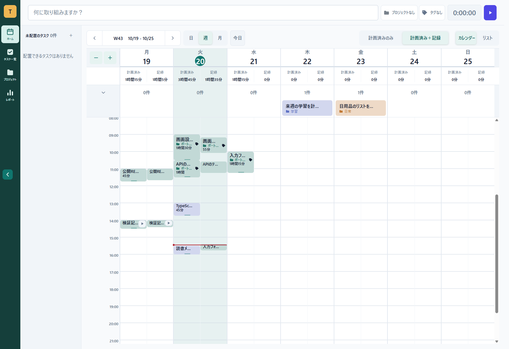
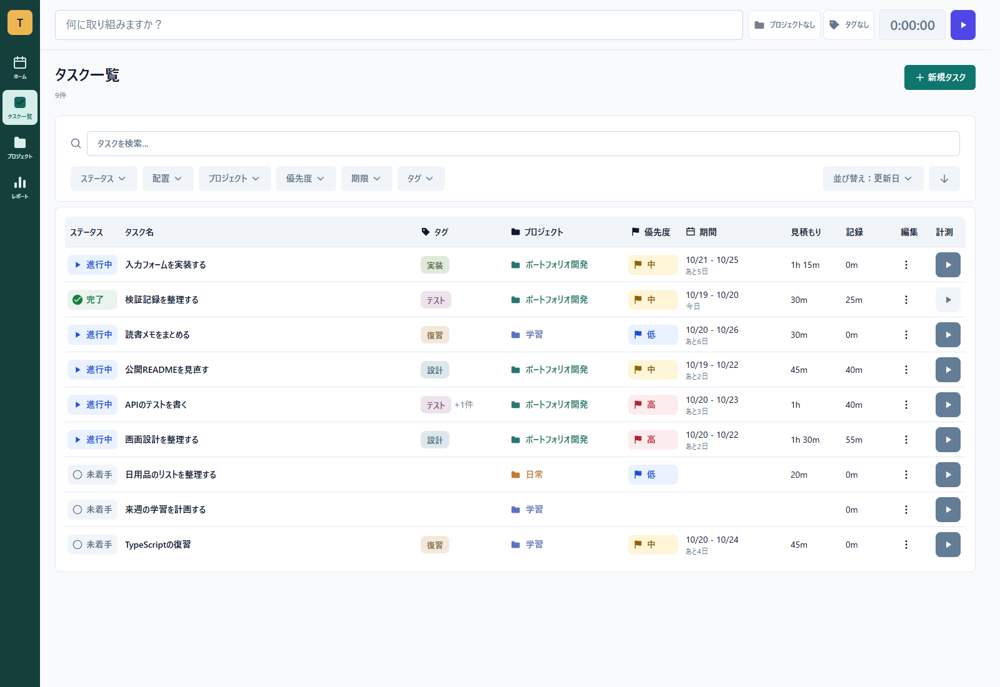
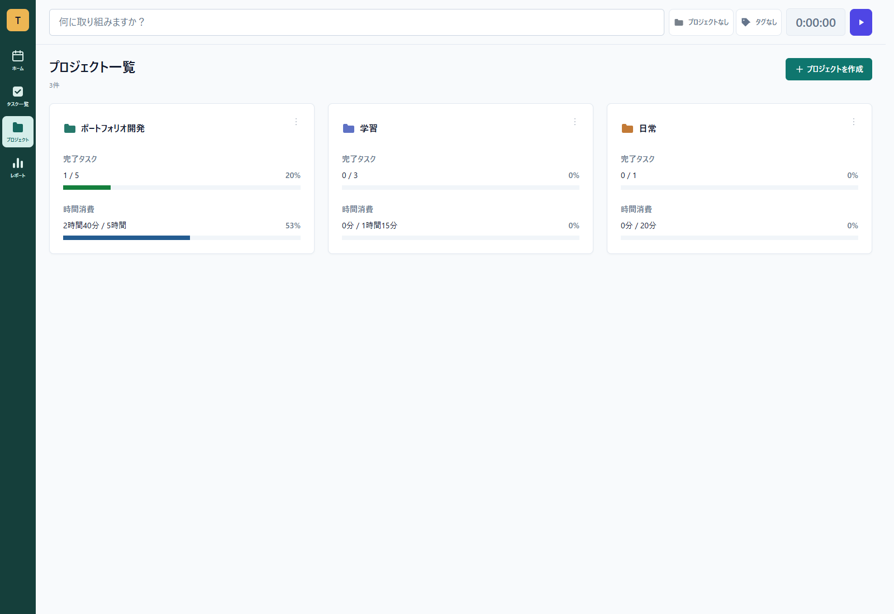
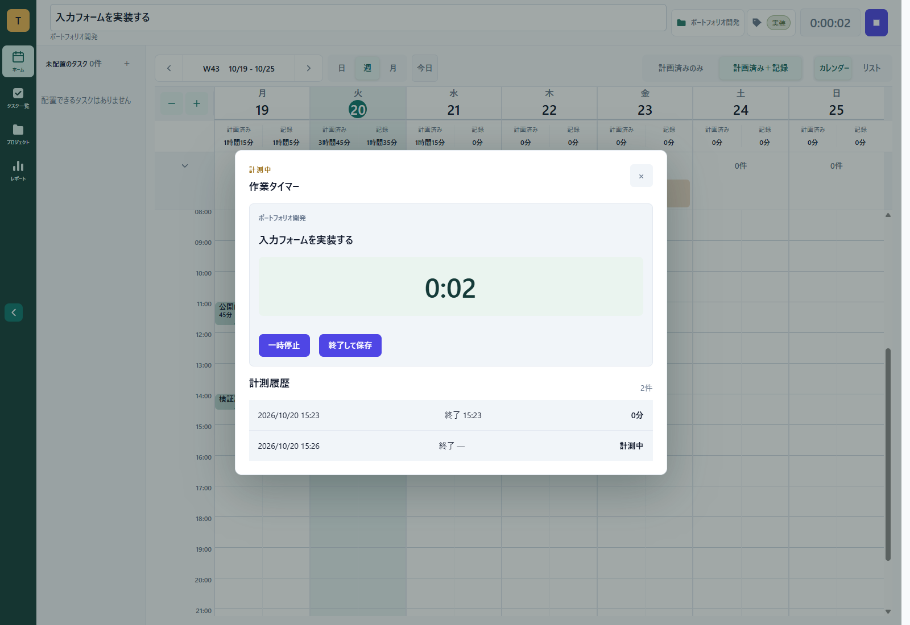
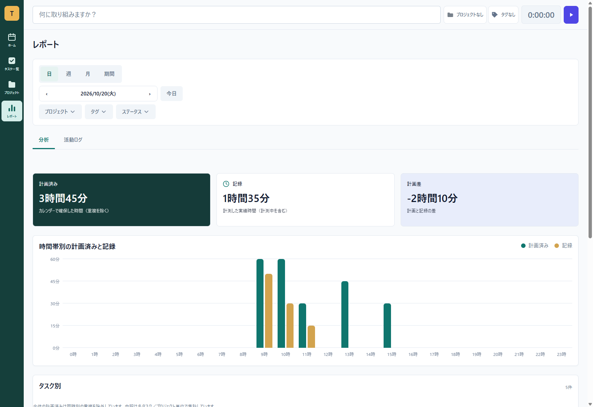
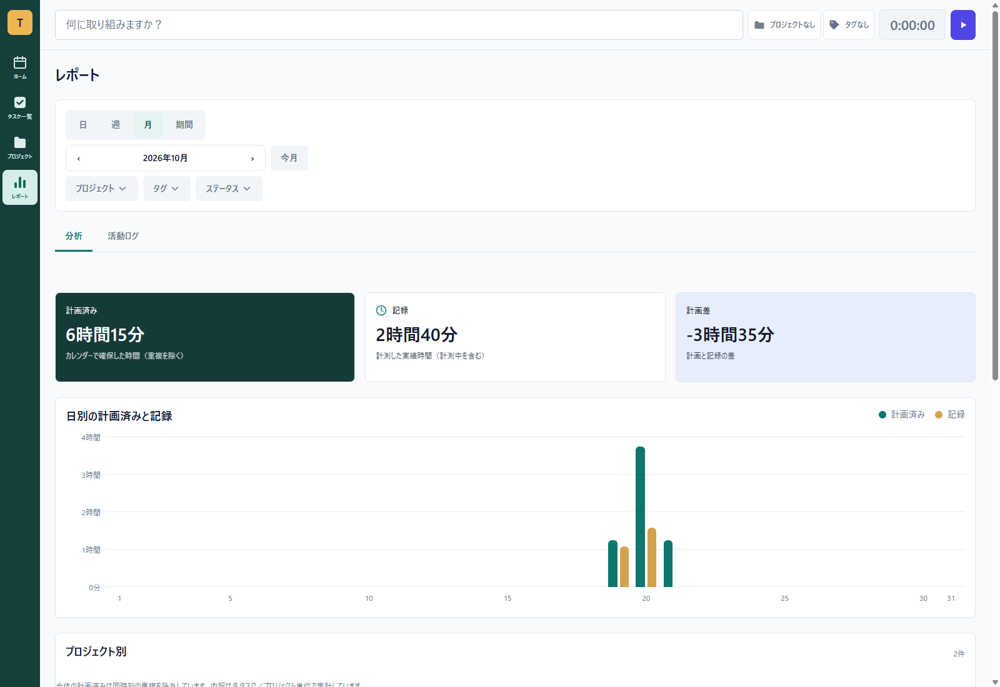
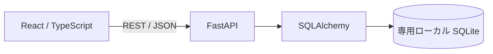

# Task Time Planner — タスク・時間管理アプリ

「何をするか」「いつ取り組むか」「実際に何分かかったか」を分けて記録し、見積・予定・実績の違いを振り返るWebアプリです。学習や個人作業で、やることを具体的な時間へ落とし込むことを目的に制作しています。

**開発継続中のポートフォリオです。** 本提出版はReact / TypeScriptとFastAPI / SQLiteによるローカルアプリです。MySQL専用基盤、正式認証、複数ユーザー向けサービスの完成版ではありません。

## 主な機能

| 場面 | この版の実装 |
|---|---|
| Plan | Taskの作成・編集・完了、開始日・締切・優先度・タグ、Project分類・識別色 |
| Schedule | 日・週・月カレンダー、未配置TaskのInbox、時刻未定・時刻指定・終日の予定、移動・Resize |
| Execute | DBに保存するTimer、停止・一時停止・再開、手動実績の追加・時刻修正・削除 |
| Review | 日・週・月・期間指定の表示、Project / Tagの絞込み、カレンダーの計画と実績の比較 |
| Protect | 単一Active Timer、実績の重複拒否、履歴付きTask / Snapshot参照Projectの削除拒否 |

Timerの停止後もTaskは自動完了しません。現在のSQLite実装では実績にTaskが必要で、開始・手動実績登録に伴う進行中化、Pause / Resume、0秒実績の保存が残ります。将来の仕様案と現在の動作は区別しています。

レポートの主表示は「計画済み（予定占有）」「記録（実績）」「計画差」です。Taskの見積はタスク表・詳細等の別項目であり、レポートの「計画済み」と同じ値として扱いません。Backend APIは見積集計も返します。

## 画面

以下は、この提出版を新規の隔離SQLite DBで起動し、架空のサンプルデータをAPIで登録して撮影した実画面です。画像の撮影結果と検証範囲は[検証記録](docs/testing.md)に記載しています。

### Home：週カレンダーで予定と記録を比較



### Tasks：状態・タグ・Project・優先度・期間を編集



### Projects：完了率と時間消費の比較



### Timer：実行中の記録と計測履歴



### Reports：日別の計画と記録



### Reports：月別の計画と記録



## 技術構成

| 層 | 技術 |
|---|---|
| Frontend | React 19 / TypeScript 6 / Vite 8、CSS、Oxlint |
| Backend | Python 3.12 / FastAPI / SQLAlchemy 2 / Pydantic 2 / Uvicorn |
| Storage | SQLite。Task・予定・実績を別テーブルで管理 |
| Test | pytest / httpx、Node.js test runner、Chrome / Edgeのブラウザ操作 |



依存の正確な版は[Backend](backend/requirements.txt)と[Frontend lockfile](frontend/package-lock.json)を参照してください。基準版からの変更は、公開前のセキュリティ修正、ローカルDB限定起動入口、公開用資料の整理に限定しています。

## 設計・実装上の工夫

- **予定と実績の分離**：Taskは作業内容、ScheduleBlockは予定、TimeEntryは実績を担当します。実績を保存しても予定を上書きしません。
- **計算する値の区別**：APIの見積集計は同日Taskを重複排除して合計し、予定占有はTIMED区間の和集合、実績は記録区間と対象日の重なりから算出します。NULL見積を0分へ書き換えません。画面のレポート主表示は予定占有・実績とその差です。
- **Timerの永続化**：実行中は `ended_at IS NULL` で表し、SQLiteの部分一意indexで同時に1件へ制限します。再読込・Backend再起動後にも同じ記録を取得します。
- **履歴の所属保持**：実績にProject Snapshotを保存し、Taskを移動しても過去の集計先を変えません。
- **入力・表示の分離**：日付・期間・時間入力、タグ・Project選択、Popup位置や通信中状態を専用コンポーネントとロジックへ分けています。
- **DBを使うテストの隔離**：app import前の一時DB選択と接続ガードを使い、通常DBをテスト入力にしません。

## ローカル起動

Python 3.12、Node.js 24、npmを用意してください。以下はWindows PowerShellの手順です。既存の開発DB・本番DB・秘密設定をコピーしないでください。Backendは`.env`を自動読込みしません。FrontendのViteは`.env`を読み込むため、`VITE_*`へ秘密値を設定しないでください。

Backend（リポジトリ直下から）：

```powershell
cd backend
python -m venv .venv
.\.venv\Scripts\python.exe -m pip install --upgrade pip==26.2.1
.\.venv\Scripts\python.exe -m pip install -r requirements-lock.txt
# このPowerShellのDB接続設定を解除します。値の表示は不要です。
Remove-Item Env:DATABASE_URL,Env:DB_BACKEND -ErrorAction SilentlyContinue
.\.venv\Scripts\python.exe -B run_portfolio.py --initialize
```

初回だけ `--initialize` を指定します。新規の `.local-data/local/portfolio.sqlite3` を作成し、SQLite Migration 003〜008を適用します。既存ファイルがあれば停止して保持し、上書きしません。エラー時にDBを削除・自動再実行しないでください。

再起動は初期化せず行います。

```powershell
.\.venv\Scripts\python.exe -B run_portfolio.py
```

APIは `http://127.0.0.1:8000`、APIドキュメントは `/docs` です。Backendが `PORTFOLIO_PORT=8000` を表示して正常起動した場合だけFrontendへ進みます。起動入口は接続先を自分のローカルSQLiteへ限定し、外部DB設定を拒否します。

Frontend（別のPowerShell、リポジトリ直下から）：

```powershell
cd frontend
npm ci
Remove-Item Env:VITE_API_BASE_URL -ErrorAction SilentlyContinue
npm run dev -- --host 127.0.0.1
```

表示されたローカルURLを開きます。ブラウザ内のAPI接続先は既定で `http://localhost:8000` です。既存DBへ接続するための環境変数は設定しないでください。

## テストと検証結果

```powershell
# backend、仮想環境の依存導入後
$env:PYTEST_DISABLE_PLUGIN_AUTOLOAD = '1'
.\.venv\Scripts\python.exe -B -m pytest tests -q -p no:cacheprovider
```

```powershell
# frontend、npm ci後
$env:TIMER_TEST_PYTHON = (Resolve-Path ..\backend\.venv\Scripts\python.exe).Path
Remove-Item Env:VITE_API_BASE_URL -ErrorAction SilentlyContinue
npm test
npm run build
npm run lint
```

FrontendテストにはChrome / Chromium / Edgeが必要です。標準配置以外では `BROWSER_PATH` を指定します。これらのテストは新しい一時SQLite DBへ書き込みます。既存DBや実データを使わない隔離条件が必要です。

検証日：2026-10-20。Windows / Python 3.12.10 / Node.js 24.14.0。

| 対象 | 結果 |
|---|---|
| Backend / pytest | **739件成功**、失敗・スキップ0、警告10件 |
| Frontend / Node.js・ブラウザ | **1,327件成功**、失敗・スキップ0 |
| TypeScript / production build | 成功 |
| Oxlint | エラー0・警告6件 |
| READMEの新規DB起動・再起動・読戻し | 成功 |
| 実画面6枚・Timer操作 | 撮影・確認済み、ブラウザ実行時例外0 |
| 依存の脆弱性照合 | npm / 公式PyPI情報で今回の対象に検出0 |

Frontend全体の実行には今回約22分かかりました。BackendのPydantic等の互換・非推奨警告と、既存Reactコードのlint警告は残っています。未確認項目を含む詳細は[検証記録](docs/testing.md)を参照してください。

## 既知の制限

- 認証・Session・Ownerによるユーザー別アクセス制御は未実装です。APIはローカル開発向けのCORS設定であり、インターネットへそのまま公開する構成ではありません。
- 実績のタグはTask側のタグを参照し、実績専用Tagとして独立保存していません。Taskなしの実績・独立した予定は未実装です。
- TimerはPauseと累積表示を含みます。正式なDiscard契約や新しい認証・データ分離仕様は今後の課題です。
- SQLiteの名称判定を、将来のMySQL完全UTF-8名称キーが完成したものとして扱いません。
- 未確認環境や既存DBの移行・復旧を保証するものではありません。警告・未実施項目は[検証記録](docs/testing.md)に記載します。

## 生成AIの活用

生成AIをコードの作成・修正、テストの作成・実行補助、調査・文書整備に活用しています。本人は制作目的・要件・優先順位、提案の採否、動作確認の範囲、公開内容を判断しています。生成されたコードも含めてレビューと理解を継続しており、全コードを独力で実装したという説明はしていません。

## 今後の改善

MySQLへの移行、正式認証とOwner認可、実績と予定の独立性の拡張、警告の解消、CIでの再現可能な検証を進める予定です。本提出版にMySQL専用MigrationコードやUserモデルを含めず、完了済みとは記載していません。

## 公開資料

- [実装範囲・主要仕様](docs/requirements.md)
- [システム構成・設計判断](docs/architecture.md)
- [SQLiteデータモデル](docs/data-model.md)
- [テスト・画面確認結果](docs/testing.md)
- [安全性・依存関係・素材](docs/security.md)
