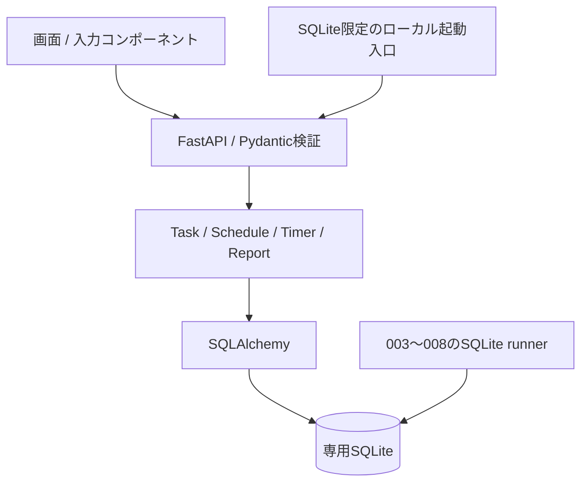

# システム構成と設計判断

React / TypeScriptの画面からFastAPIへREST / JSONでアクセスし、SQLAlchemyで専用SQLiteを扱います。フロントの日時入力・集計表示と、サーバーの検証・保存・集計を分けています。

`backend/app` がAPI・モデル・集計、`backend/migrations` がSQLite専用履歴、`frontend/src` が画面と状態管理です。日付・期間・Popup・識別色・レポート計算などは独立した部品に分けています。大きなWorkspaceコンポーネントは残っており、さらに分割する余地があります。

Task・ScheduleBlock・TimeEntryはそれぞれ「作業内容」「予定」「実績」です。予定と実績を直接結合するFKはありません。予定変更でTaskの作業見積や過去実績を補正しません。

実行中Timerの根拠はDBの `ended_at IS NULL` です。フロントの経過表示は補助で、保存結果はAPI応答で確認します。SQLiteの部分一意indexは同時Activeを1件に制限します。User単位の制約ではありません。

実績はUTCとして扱い、IANA timezoneのローカル日境界と重ねて集計します。現在はEntryごとに分未満を切り捨てる方式と端末Timezoneに依存する表示が残ります。将来の固定Timezone・丸め契約が完了したという説明はしていません。

SQLiteはapp import時にMigrationを呼ぶため、ローカル入口を先に通して接続先を固定します。初回だけ新規ファイルを排他的に確保し、003〜008の承認フラグをそのDBへ適用します。通常起動は既存の専用ファイルのみを受け付けます。失敗時に自動削除・初期化・再実行を行いません。

同梱のPreview補助コード・Dockerfileは、既存の安全性テストとの整合を保つために残しています。通常起動はルートREADMEのSQLite入口です。Railway設定・資格情報・実デプロイ状態は含めず、クラウド動作確認済みとは扱いません。
