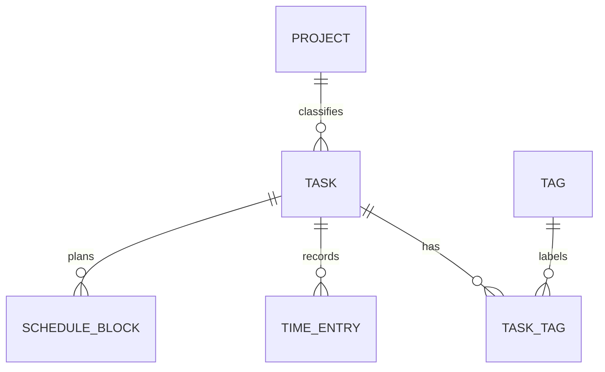

# SQLiteデータモデル

対象はこの提出版で実装されている5モデルとTask–Tagの関連です。User / Account / Session / Owner認可テーブルはありません。

| テーブル | 主な列・意味 |
|---|---|
| projects | Integer主キー、名前、NULL可の識別色、作成・更新日時 |
| tasks | タイトル、NULL可見積、優先度、開始日・締切、NULL可Project、状態、完了Snapshot |
| tags | 名前の一意制約・SQLite長CHECK、NULL可識別色、作成・更新日時 |
| task_tags | task_id / tag_idの複合主キー。Tag側検索用index |
| schedule_blocks | 必須Task、ローカル日付、種別、NULL可開始時刻・予定時間、種別と列のCHECK |
| time_entries | 必須Task、Project Snapshot、UTC開始・NULL可終了、作成・更新日時 |
| schema_migrations | SQLite専用の003〜008の履歴記録 |

`planned_date` / `planned_start_time` は互換列です。現行の予定表示・Inbox・日見積はScheduleBlockから算出します。Task開始日・締切をScheduleBlockとして自動生成しません。

TimeEntryのProject Snapshotは現在のTask所属とは独立し、Project FKで現在所属へ追随させません。Task移動後も当時の所属による集計を維持します。

ORMには削除cascadeの定義が残る一方、APIは実績付きTask・Snapshot参照Projectの削除を拒否します。APIによる履歴保護とDBの外部キー有効化は別の事項です。外部ツールからDBを直接更新しても同じ業務制約が自動保証されるという説明はしていません。

現在の名前保存・255文字制約等を、未確定の将来MySQL名称仕様へ流用したという意味ではありません。大文字小文字、末尾空白、UTF-8キーの新しい仕様はこの整理で追加していません。
